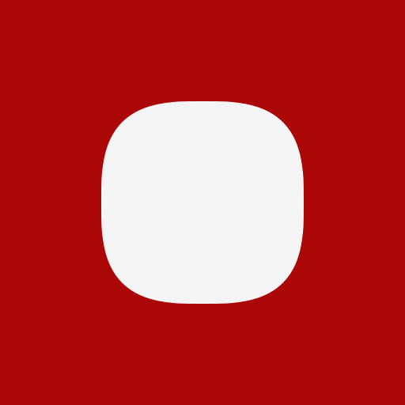

# Superellipse: Inkscape extension

An Inkscape extension for generating superellipse shapes, including squircles. 

  
    

## Parameters

| Parameter | Description | Range | Default |
|---|---|---|---|
| Unit | Measurement unit | cm, in, pt, pc, mm, px | px |
| Width | Shape width | 1–2048 | 128 |
| Height | Shape height | 1–2048 | 128 |
| Exponent | Controls corner curvature | 1–18 | 3 |
| Corner Ratio | Controls corner radius | 0–1 | 0.62 |
| Precision Level | Bézier approximation precision | 1–6 | 3 |

An exponent of 2 produces circular corners, while a higher exponent produces squarer corners.

## Output

The extension creates a closed SVG path in the current layer, centered on the document's viewBox.

## Installation

1. Download or clone this repository.
2. Place this folder `superellipse_inkscape-extension` in your Inkscape extensions directory.  
[mac, linux] `~/.config/inkscape/extensions`  
[windows] `C:\Users[yourUsername]\AppData\Roaming\inkscape\extensions`  
4. Restart Inkscape.

The extension is available under `Extensions` → `Render` → `Superellipse`.

## License

MIT
